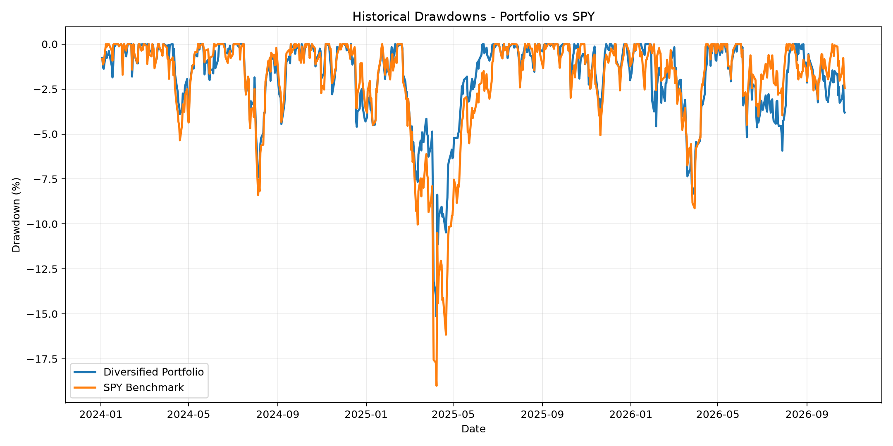
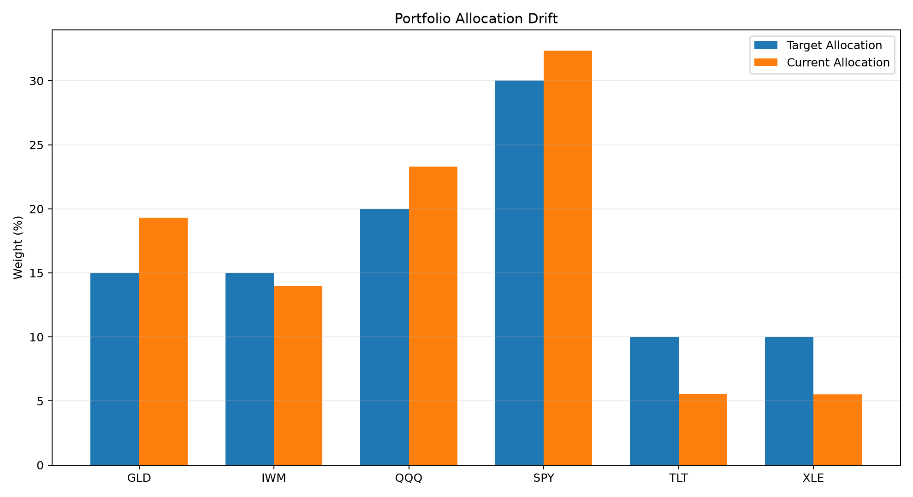

# Portfolio Risk Intelligence Engine

A Python-based portfolio analytics and risk intelligence project that evaluates historical ETF performance, downside risk, concentration, and benchmark-relative returns using market data, SQLite, and automated reporting.

## Project Overview

This project models a $100,000 buy-and-hold portfolio consisting of six exchange-traded funds (ETFs), with an initial investment date of January 2, 2024 and market observations through October 23, 2026.

It demonstrates an end-to-end analytical workflow: market data ingestion, transaction storage, portfolio valuation, quantitative risk measurement, performance attribution, visualization, and automated report generation.

## Portfolio Composition

| ETF | Exposure | Initial Target Weight |
|---|---|---:|
| SPY | US Large-Cap Equity | 30% |
| QQQ | US Growth Equity | 20% |
| IWM | US Small-Cap Equity | 15% |
| GLD | Gold | 15% |
| TLT | US Treasuries | 10% |
| XLE | Energy | 10% |

The portfolio uses whole-share purchases and retains uninvested cash.

## Key Results

Historical analysis from January 2024 through October 2026, using 705 aligned daily return observations.

| Metric | Diversified Portfolio | SPY Benchmark |
|---|---:|---:|
| Ending Value | $156,975.11 | $160,789.17 |
| Cumulative Return | 56.98% | 60.79% |
| Annualized Return | 17.49% | 18.50% |
| Annualized Volatility | 13.63% | 15.46% |
| Maximum Drawdown | 15.16% | 19.00% |
| Sharpe Ratio | 1.25 | 1.18 |

### Key Findings

- The diversified portfolio underperformed SPY by 3.81 percentage points in cumulative returns.
- Annualized volatility was 1.83 percentage points lower than SPY.
- Maximum drawdown was 3.84 percentage points lower than SPY.
- The portfolio achieved a higher historical Sharpe ratio (1.25 versus 1.18), assuming a 0% risk-free rate.
- Portfolio beta against SPY was approximately 0.81.
- Historical 95% daily Value at Risk (VaR) was 1.38%, while Conditional Value at Risk (CVaR) was 2.00%.

These findings illustrate the trade-off between absolute performance and historical risk-adjusted returns.

## Portfolio Visualizations

### Portfolio Growth vs SPY


### Historical Drawdowns



### Allocation Drift



### ETF Performance Attribution


## Features

- Historical market data ingestion and storage
- SQLite-based portfolio and transaction management
- Cash-flow-aware portfolio return calculations
- Benchmark performance comparison
- Annualized volatility and maximum drawdown
- Historical Value at Risk and Conditional Value at Risk
- Portfolio beta and concentration analysis
- Security-level performance attribution
- Portfolio allocation drift visualization
- Automated Markdown reporting
- Automated testing with pytest

## Technology Stack

**Python · Pandas · NumPy · Matplotlib · SQLite · Tiingo · yfinance · pytest**

## Project Structure

```text
portfolio-risk-engine/
├── src/riskengine/
│   ├── db/           # Database models and transaction operations
│   ├── ingestion/    # Market data ingestion
│   └── risk/         # Risk, returns, attribution and reporting
├── scripts/          # Analysis and visualization scripts
├── tests/            # Automated test suite
├── reports/          # Generated reports and charts
├── data/             # Local databases (excluded from Git)
├── pyproject.toml
└── README.md
```

## Windows local quickstart

Requires Python 3.11 or later and Node.js/npm on PATH. From Windows CMD:

```cmd
git clone <repository-url>
cd portfolio-risk-engine
python -m venv .venv
.venv\Scripts\activate
python -m pip install -e ".[dev]"
cd frontend
npm.cmd ci
cd ..
```

Replace `<repository-url>` with the actual GitHub repository URL.

Provision a usable Portfolio Risk Engine SQLite database before starting. By default FastAPI opens
`data\historical_portfolio.db`. Historical database files are excluded from Git, and a fresh checkout
does not include a usable database. To use an existing database elsewhere, set `RISKENGINE_DB` to its path.
`RISKENGINE_DEMO=1` takes precedence over `RISKENGINE_DB` and selects `data\demo_portfolio.db`, which must also
be provisioned. Use `set "RISKENGINE_DEMO="` in CMD to clear demo mode.

```cmd
rem Optional: select a portfolio ID that exists in the chosen database on launch
set "VITE_PORTFOLIO_ID=1"
dev.cmd
```

Use the browser tab opened by `dev.cmd`. Before printing `Ready`, the launcher verifies database
readiness and waits for the current browser session to return its cookie in a successful
authenticated session check. The backend confirms this on its private launcher connection.
The displayed URL contains no launch code.
While FastAPI is running, http://127.0.0.1:8000/health checks process liveness and
http://127.0.0.1:8000/ready checks database access and required schema. If startup reports a database
problem, check which file the environment selects and whether it exists, is readable, and has the
application schema. An invalid configured portfolio is explained in the browser, where you can choose another one.
An empty database can pass readiness.
Type `stop` then Enter (or press Ctrl+C), wait for shutdown, and run `dev.cmd` again after changing settings.
See the [frontend README](frontend/README.md) for the seven routes and port overrides.

### Local access protection

`dev.cmd` runs both listeners on IPv4 loopback. Use the exact `127.0.0.1` address and configured
port. `localhost`, IPv6, other hosts and forwarded host overrides are rejected in protected mode.
The Vite proxy preserves the original Host. The API checks that Host and any supplied Origin
match the configured local access policy. Cross-site browser request metadata and null Origin
are rejected. Missing Origin is allowed for authorized reads and local probes. Cross-origin
requests receive no CORS grant.

The launcher opens the browser with a random, single-use launch code in the URL fragment.
It expires after three minutes and can be briefly visible in the Windows dispatch arguments and
browser navigation state. The app removes the fragment before exchanging the code in a request
header. The launcher does not print it. The backend issues an in-memory, host-only, HttpOnly,
SameSite=Strict session cookie scoped to `/api`. Development uses loopback HTTP, so the cookie
does not require HTTPS. A session lasts at most 12 hours and is invalidated on backend restart.
Refresh and other tabs in the same browser profile can reuse it.

Allow cookies for this local application and use the tab opened by `dev.cmd`. Browser authorization
must be confirmed within 30 seconds of dispatch. If it fails, the launcher reports the problem and
stops its servers. Check your browser's site-specific cookie settings and default browser setup,
then run `dev.cmd` again. On session loss the app clears its financial views on the next failed
request, focus check, or scheduled session check. Background tabs can delay the scheduled check.
Refresh if a new launcher tab already established a session. Otherwise restart `dev.cmd`.

All financial API routes, including report exports, require a valid session and use `no-store`.
`/health` and `/ready` remain session-independent under the local Host and Origin rules.
Interactive API docs and OpenAPI are hidden in protected mode. An unsafe API request
must use the exact browser Origin, a valid session, and the non-simple `X-RiskEngine-Request`
header. Portfolio creation and renaming are the supported browser changes.

Protected startup fails if its launcher configuration is unavailable. An explicit
`RISKENGINE_API_MODE=legacy-read-only` is available for isolated developer read-contract testing.
It bypasses local access guards and refuses unsafe HTTP methods. Keep it on loopback with disposable
data. The supported launcher always selects protected mode. The cookie and same-origin exchange
can be reused with future same-origin asset serving. Production packaging is separate work.

This protects against unrelated websites, cross-origin requests, CSRF, DNS rebinding, and direct
requests without the session. The application does not isolate other processes running as the same
OS user. Malware, a compromised browser or privileged extension, administrator access, and physical
access to an unlocked device are outside this boundary. Different browser-facing ports use
different cookie names, so legitimate instances with separate project directories and port pairs
can run in one browser profile. Cookies are scoped by host and path. Their names prevent collisions
between instances and do not provide confidentiality across TCP ports. A local process that owns
another port on the same host is outside this threat model.

### Set up a managed database

After installing the backend in `.venv`, run one of these commands from the repository root in
Windows CMD. Both create a new `%LOCALAPPDATA%\Portfolio Risk Engine\portfolio.db`.

```cmd
.venv\Scripts\python.exe -m riskengine.db.lifecycle create
.venv\Scripts\python.exe -m riskengine.db.lifecycle adopt "D:\My Portfolio\existing.db"
```

`create` starts with empty tables. `adopt` copies a compatible database using a SQLite snapshot,
including committed WAL data visible to SQLite. It leaves the source database in place. Both
commands refuse to replace an existing database. Use `--data-root "D:\My Portfolio\Isolated"` after
the subcommand to choose a different absolute local directory outside the repository.

SQLite locates journal, WAL and shared-memory files using the database filename. Both
`adopt` and `inspect` reject a source with multiple filesystem hard links because SQLite
could read a different set of journal files and miss committed data. Use a standalone copy made
with a supported SQLite backup or export. Read-only WAL access preserves the source's financial
records and schema version. SQLite can still create sidecars or update shared-memory state.
The path checks address ordinary misuse and supported concurrent setup operations. They do not
provide isolation from arbitrary filesystem changes by another process running as the same OS user.

```cmd
.venv\Scripts\python.exe -m riskengine.db.lifecycle inspect "%LOCALAPPDATA%\Portfolio Risk Engine\portfolio.db"
set "RISKENGINE_DEMO="
set "RISKENGINE_DB=%LOCALAPPDATA%\Portfolio Risk Engine\portfolio.db"
dev.cmd
```

`inspect` checks compatibility and reports the schema version. The original V1 schema uses version
0. Managed copies and new databases use version 1 with the same financial schema. Setup checks the
project's schema definitions conservatively and can reject customized schemas. Compatibility does
not require portfolio records or complete market-price history. Setup does not change the launcher's
default database selection or upgrade an existing database in place.

Adoption stops after 30 seconds of continuously reported SQLite backup contention. The timer
resets when backup makes progress, and individual SQLite calls can take additional time.
An abrupt interruption can leave an unpublished `.portfolio-setup-*.db` file. The next attempt uses
a new temporary filename. If cleanup fails, setup reports the retained path.

### Opt in to managed write access for development

A protected browser session authorizes API requests. The backend separately decides whether
its startup-selected database is eligible for writable connections. For a database provisioned
with `create` or `adopt`, use the following Windows CMD configuration:

```cmd
set "RISKENGINE_DEMO="
set "RISKENGINE_API_MODE="
set "RISKENGINE_DB=%LOCALAPPDATA%\Portfolio Risk Engine\portfolio.db"
set "RISKENGINE_WRITE_DATA_ROOT=default"
dev.cmd
```

For an isolated managed directory created with `--data-root`, set
`RISKENGINE_WRITE_DATA_ROOT` to that same absolute local directory and
`RISKENGINE_DB` to its `portfolio.db`. Clear the write opt-in with
`set "RISKENGINE_WRITE_DATA_ROOT="`. These are developer settings. The browser supports creating portfolios and renaming them.

Demo selection still takes precedence, followed by the explicit database override and the
historical default. Writable access requires protected mode and a match between the effective
explicit database and the opted-in managed path. Demo, historical default, and legacy-read-only
operation stay read-only. An arbitrary explicit database remains readable under the existing API
rules. Schema version 1 and matching table and index definitions establish compatibility.
The trusted startup opt-in authorizes the location. Startup creates and adopts no databases.

The boundary reuses the managed directory rules outside the repository, checks resolved paths,
and rejects links or unreliable identity on the target and its SQLite sidecars. Windows path
comparison follows Windows case rules. A directory alias resolving inside the repository still
fails the managed directory check. Authorization applies to the configured location, so a
compatible replacement at that location can be accepted between opens. Pathname identity
checks around opening do not pin the startup file. Keep the active database in place while
the application is running. Use the offline maintenance workflow below.
The boundary assumes the OS user trusts other processes that can change their files and does not
sandbox developer scripts, Streamlit writers, ingestion jobs, or external SQLite tools.

The write capability opens an existing file with SQLite URI `mode=rw` and checks its schema
and identity. Each connection verifies foreign-key enforcement, uses a two-second SQLite
busy timeout and leaves persistent journal mode alone. The lifecycle `inspect` command
also checks existing data integrity.

The file permission check and successful SQLite initialization establish prerequisites for
writing. A statement can still fail because of directory permissions, journal creation,
contention, disk conditions or other runtime errors. The timeout applies to SQLite lock
contention, with no overall deadline for a connection or transaction.

If SQLite reports that rollback journal recovery is required during read-only validation,
the connection boundary refuses writable access and leaves the database and journal intact.
Keep both files together and use the controlled offline recovery workflow below. The application
does not recover journals automatically. A non-hot rollback journal and ordinary WAL sidecars
can remain usable.

### Manage local portfolios

The portfolio selector is shared across the seven pages. A valid explicit
`VITE_PORTFOLIO_ID` takes precedence at launch. If the configured ID is invalid, choose
manually. Without an explicit value, the app chooses ID 1 when available, then a sole
supported portfolio. With several other choices, select one to open the financial pages.
Selection stays in memory for the current database context. A portfolio switch resets
page controls. Renaming preserves the applied analysis and its draft controls.

An empty writable managed database shows the first-portfolio form. Create a portfolio in
USD or EUR, then use **Manage portfolios** to rename it. Names permit 1 to 80 normalized
characters, collapse whitespace, and are compared without case. International names may
use join controls. Unsafe formatting and invisible-only names are rejected. Existing
names and currencies, including legacy currencies, are preserved. Unsupported legacy IDs
are shown as exact diagnostics while supported IDs remain selectable. Read-only databases
can be viewed and switched. The directory reports an advisory write availability check.
The server still authorizes and validates the database for every write.

If a change loses its acknowledgement, choose **Check change status**. A directory refresh
can show the current data while the earlier change is still running. If execution has not
claimed the prepared ticket, **Close if unstarted** can permanently close it. A running
ticket remains blocked. If a result is no longer available after expiry, session loss or
restart, inspect the directory and explicitly acknowledge that the change may have saved
before submitting a new change. The browser never retries a write automatically.

A ticket admits at most one transaction executor entry within the issuing backend
generation. The backend retains running entries and keeps terminal outcomes for a
limited time. The tab stores an opaque pending marker before dispatch so a reload in that
tab can check the outcome. Clearing storage or closing the tab can lose the marker.
Other tabs can issue independent operations. A backend restart fences old tickets and can
lose the evidence needed to resolve a previous operation. The protocol has no durable
exactly-once guarantee and uses the existing managed database schema.

### Execute an application transaction

FastAPI mutation services use `app.state.database_transactions.run(operation)` after
request authorization. The protected local API verifies the request and session. The managed
database capability verifies the startup-selected target. The executor then acquires a fresh
connection and begins `BEGIN IMMEDIATE` before invoking the synchronous operation. Put
state-dependent financial reads and validation inside that callback so they share the same
snapshot as the writes. Raise `MutationRejected` to reject invalid financial state or input.

The callback receives a thread-bound `Transaction` with
`execute(sql, parameters=())`, which returns materialized rows as tuples. Return plain
scalar data or lists, tuples and string-keyed dictionaries of plain data. Live database
resources and asynchronous operations are rejected. SQLite's authorizer limits callback
SQL to data statements and blocks transaction control, savepoints, attachments, PRAGMAs
and schema changes. A statement failure or interruption poisons the transaction even if the
callback catches it. Interruption exceptions retain their original type. The handle expires
when the callback exits. Nested executor calls in the
same execution context fail immediately. Keep callbacks short and synchronous on one worker
thread, with no spawned transaction workers or external side effects.

SQLite's write reservation serializes writers for the same database across connections and
processes. The executor uses SQLite's lock and performs no automatic retry. It commits only after
successful callback execution and result validation. It attempts rollback on failure and
always attempts connection cleanup. `TransactionError` reports a reason, phase and outcome.
`not_started` and `rolled_back` describe confirmed outcomes. `unknown` covers failures
where the transaction state does not establish what persisted. A cleanup failure after a
successful commit reports `committed`. Portfolio management can return the retained result
when the executor confirms commit. An `unknown` outcome needs explicit reconciliation.
Log primary and secondary errors internally and omit their raw causes from public errors.

These rules govern supported application callbacks. Same-user file manipulation and trusted
process internals remain outside the boundary. Financial ledger editing and durable
idempotency are deferred.

### Back up, restore, or recover a managed database

Run these commands from the repository root in Windows CMD. With no `--data-root`, the
maintenance CLI uses `%LOCALAPPDATA%\Portfolio Risk Engine\portfolio.db`. An isolated root must
be the same absolute local directory used during provisioning or adoption. Maintenance uses
this explicit target and the managed path, identity, schema and sidecar rules. Browser request
credentials and `RISKENGINE_DB` do not select a maintenance target.

```cmd
.venv\Scripts\python.exe -m riskengine.db.maintenance backup
.venv\Scripts\python.exe -m riskengine.db.maintenance backup --data-root "D:\Sandbox\Portfolio"
.venv\Scripts\python.exe -m riskengine.db.maintenance verify "D:\Sandbox\Portfolio\backups\BACKUP-NAME.riskbackup"
```

Backup works while the supported application is running. SQLite's backup API copies a
consistent committed snapshot, including committed records still in the WAL, while excluding
uncommitted writes. The snapshot can precede later commits. SQLite backup cancels after
30 seconds of continuous reported BUSY/LOCKED contention, with no overall wall-clock deadline.
The source journal mode stays unchanged. The published `.riskbackup` is a single ZIP bundle
containing a standalone rollback-journal-format `portfolio.db` and a versioned manifest
with UTC time, schema version, size and SHA-256. The local `backups` directory uses UTC
names with random suffixes, and publication refuses collisions. Verification checks the
manifest, digest, exact schema, `integrity_check` and `foreign_key_check` in disposable
storage. These checks establish compatibility and consistency. Verification and restore
reject archived WAL-mode images because the bundle must contain a complete database image
without sidecars. Live WAL-mode
databases remain supported as backup sources. Verification and restore need temporary disk
space for a full extracted image, and restore also retains a separate safety backup.
SHA-256 provides no provenance if someone can rewrite both parts of the bundle. Financial
records can be structurally valid and still contain bad inputs.
Use lifecycle adoption for standalone SQLite files.

**Backups and preserved recovery files contain private financial information.** Keep them in
storage you control. A backup on the same physical disk offers no protection from disk failure
or device loss. Keep an independent copy accordingly.

For restore or recover, stop `dev.cmd` and wait for backend and frontend shutdown. Stop any
direct API servers, Streamlit instances, lifecycle inspect or adoption commands, and external
SQLite tools using the database. FastAPI reserves the canonical `portfolio.db` location for
managed readers and holds shared ownership on the adjacent `.portfolio-access.lock` before
starting, even when started from another checkout. Startup fails if ownership cannot be
established or maintenance is pending. This coordination only affects the ownership file.
The existing managed write policy separately determines where application or maintenance
writes are allowed. Online backup also takes shared ownership. Offline maintenance takes
exclusive ownership with bounded SQLite lock waits. The OS releases ownership
on process exit. Leave the ownership database in place. Streamlit, lifecycle commands
and external SQLite tools are outside this protocol. It assumes cooperating application
processes and a local filesystem with reliable SQLite locking.

```cmd
.venv\Scripts\python.exe -m riskengine.db.maintenance restore "D:\Sandbox\Portfolio\backups\BACKUP-NAME.riskbackup" --data-root "D:\Sandbox\Portfolio" --confirm
.venv\Scripts\python.exe -m riskengine.db.maintenance recover --data-root "D:\Sandbox\Portfolio" --confirm
.venv\Scripts\python.exe -m riskengine.db.maintenance check-active --data-root "D:\Sandbox\Portfolio" --confirm
set "RISKENGINE_DEMO="
set "RISKENGINE_DB=D:\Sandbox\Portfolio\portfolio.db"
dev.cmd
```

Run only the maintenance command appropriate for the situation.

- **Restore** requires an existing, valid active database without SQLite sidecars. Close every
  SQLite user and allow SQLite to checkpoint or cleanly close before retrying. Keep any remaining
  WAL, SHM, or journal with the database and investigate it offline. Restore verifies the selected
  bundle, retains a verified `pre-restore-*.riskbackup`, prepares the replacement on the same
  volume, and verifies the active database after replacement. A missing or damaged target is
  refused so the workflow cannot discard the only recoverable copy.
- **Recover** supports a single-database hot rollback journal from the supported application.
  Use it only when the journal belongs to that database and no attached-database transaction was
  involved. It preserves the original database and journal bytes together under `recovery`,
  rehearses recovery on a disposable copy with matching basenames, and invokes SQLite's own
  recovery on the active file only after validating the rehearsal. It checks the result against
  the rehearsal and retains the original pair. This workflow does not salvage damaged databases,
  repair foreign-key violations, or recover arbitrary WAL or multi-database transactions.
- **Check active** acknowledges a pending maintenance outcome only after validating the active
  database and matching a recorded SHA-256 for a valid state. For recovery, only the verified
  rehearsal digest is eligible. An interrupted or unverified replacement or recovery
  leaves a marker that blocks normal startup. Keep the bundle, safety backup, marker, and any
  recovery files together. If acknowledgement fails, leave the database offline for inspection.
  Do not retry replacement blindly or remove journals manually.

Temporary files and a pending marker make failure states observable on a cooperating local
filesystem. They do not provide verified power-loss durability or protection from arbitrary
same-user file changes. Scheduling, retention, encryption, cloud sync and off-device backup
management remain outside this CLI.

Run the write-boundary tests with
`.venv\Scripts\python.exe -m pytest tests\test_application_writes.py -q`.
If overriding pytest's temporary root, use a unique disposable directory outside the repository.
Pytest can retain an explicit `--basetemp` between runs. Clean up only artifacts owned by that run.

### Run Tests

```cmd
python -m pytest tests\ -q -m "not network"
```

### Historical Data

The historical portfolio database is not included in the repository. Historical data ingestion uses Tiingo and requires an API key.

The historical portfolio builder is available at:

```text
scripts/build_historical_portfolio.py
```

The generated historical portfolio report is available at:

```text
reports/portfolio_intelligence_report.md
```

The portfolio builder creates a new local historical database and should not be rerun against an existing database without reviewing its initialization behavior.

## Methodology and Limitations

- The portfolio follows a buy-and-hold investment strategy.
- Performance is calculated from historical market observations.
- Portfolio returns account for external cash flows.
- The SPY benchmark uses raw closing prices rather than dividend-adjusted total returns.
- Dividends and distributions are not explicitly modeled in the benchmark comparison.
- Annualization assumes 252 trading days per year.
- The Sharpe ratio assumes a 0% annual risk-free rate.
- Concentration metrics exclude uninvested cash.
- Exposure classifications describe investment styles and asset classes, not necessarily underlying industry-sector allocations.
- Historical risk measurements do not guarantee future performance.

## Detailed Report

See [Portfolio Intelligence Report](reports/portfolio_intelligence_report.md) for the complete risk assessment, performance comparison, exposure analysis, and visualizations.

---

*This project is intended for portfolio analytics, financial risk analysis, and educational demonstration. It is not investment advice.*
