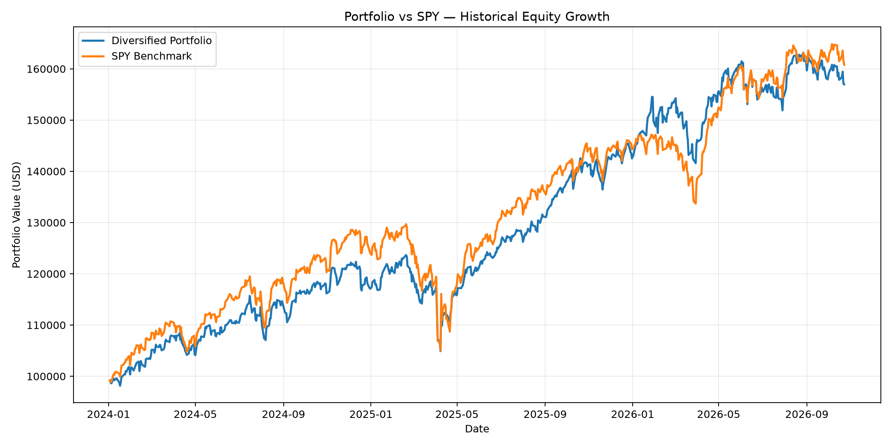
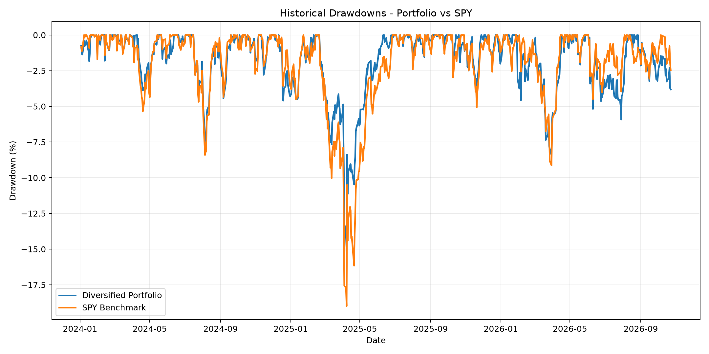
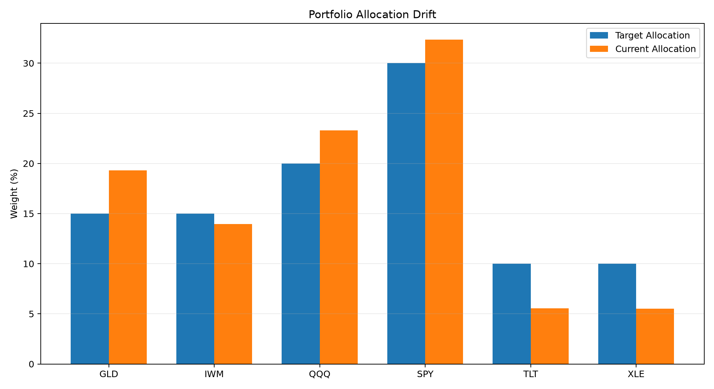
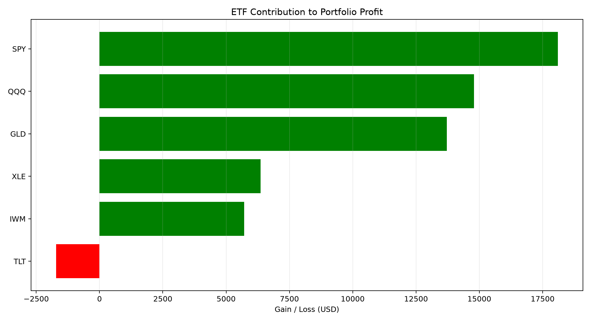

# Portfolio Risk Intelligence Engine

A Python-based portfolio analytics and risk intelligence project that evaluates historical ETF performance, downside risk, concentration, and benchmark-relative returns using market data, SQLite, and automated reporting.

## Project Overview

This project models a $100,000 buy-and-hold portfolio consisting of six exchange-traded funds (ETFs), with an initial investment date of January 2, 2024 and market observations through October 23, 2026.

It demonstrates an end-to-end analytical workflow: market data ingestion, transaction storage, portfolio valuation, quantitative risk measurement, performance attribution, visualization, and automated report generation.

## Portfolio Composition

| ETF | Exposure | Initial Target Weight |
|---|---|---:|
| SPY | US Large-Cap Equity | 30% |
| QQQ | US Growth Equity | 20% |
| IWM | US Small-Cap Equity | 15% |
| GLD | Gold | 15% |
| TLT | US Treasuries | 10% |
| XLE | Energy | 10% |

The portfolio uses whole-share purchases and retains uninvested cash.

## Key Results

Historical analysis from January 2024 through October 2026, using 705 aligned daily return observations.

| Metric | Diversified Portfolio | SPY Benchmark |
|---|---:|---:|
| Ending Value | $156,975.11 | $160,789.17 |
| Cumulative Return | 56.98% | 60.79% |
| Annualized Return | 17.49% | 18.50% |
| Annualized Volatility | 13.63% | 15.46% |
| Maximum Drawdown | 15.16% | 19.00% |
| Sharpe Ratio | 1.25 | 1.18 |

### Key Findings

- The diversified portfolio underperformed SPY by 3.81 percentage points in cumulative returns.
- Annualized volatility was 1.83 percentage points lower than SPY.
- Maximum drawdown was 3.84 percentage points lower than SPY.
- The portfolio achieved a higher historical Sharpe ratio (1.25 versus 1.18), assuming a 0% risk-free rate.
- Portfolio beta against SPY was approximately 0.81.
- Historical 95% daily Value at Risk (VaR) was 1.38%, while Conditional Value at Risk (CVaR) was 2.00%.

These findings illustrate the trade-off between absolute performance and historical risk-adjusted returns.

## Portfolio Visualizations

### Portfolio Growth vs SPY



### Historical Drawdowns



### Allocation Drift



### ETF Performance Attribution



## Features

- Historical market data ingestion and storage
- SQLite-based portfolio and transaction management
- Cash-flow-aware portfolio return calculations
- Benchmark performance comparison
- Annualized volatility and maximum drawdown
- Historical Value at Risk and Conditional Value at Risk
- Portfolio beta and concentration analysis
- Security-level performance attribution
- Portfolio allocation drift visualization
- Automated Markdown reporting
- Automated testing with pytest

## Technology Stack

**Python · Pandas · NumPy · Matplotlib · SQLite · Tiingo · yfinance · pytest**

## Project Structure

```text
portfolio-risk-engine/
├── src/riskengine/
│   ├── db/           # Database models and transaction operations
│   ├── ingestion/    # Market data ingestion
│   └── risk/         # Risk, returns, attribution and reporting
├── scripts/          # Analysis and visualization scripts
├── tests/            # Automated test suite
├── reports/          # Generated reports and charts
├── data/             # Local databases (excluded from Git)
├── pyproject.toml
└── README.md
```

## Installation

Requires Python 3.11 or later.

```cmd
git clone <repository-url>
cd portfolio-risk-engine
python -m venv .venv
.venv\Scripts\activate
python -m pip install -e ".[dev]"
```

Replace `<repository-url>` with the actual GitHub repository URL.

### Run Tests

```cmd
python -m pytest tests\ -q
```

Latest local test result: **309 passed, 2 deselected**.

### Historical Data

The historical portfolio database is not included in the repository. Historical data ingestion uses Tiingo and requires an API key.

The historical portfolio builder is available at:

```text
scripts/build_historical_portfolio.py
```

The generated historical portfolio report is available at:

```text
reports/portfolio_intelligence_report.md
```

The portfolio builder creates a new local historical database and should not be rerun against an existing database without reviewing its initialization behavior.

## Methodology and Limitations

- The portfolio follows a buy-and-hold investment strategy.
- Performance is calculated from historical market observations.
- Portfolio returns account for external cash flows.
- The SPY benchmark uses raw closing prices rather than dividend-adjusted total returns.
- Dividends and distributions are not explicitly modeled in the benchmark comparison.
- Annualization assumes 252 trading days per year.
- The Sharpe ratio assumes a 0% annual risk-free rate.
- Concentration metrics exclude uninvested cash.
- Exposure classifications describe investment styles and asset classes, not necessarily underlying industry-sector allocations.
- Historical risk measurements do not guarantee future performance.

## Detailed Report

See [Portfolio Intelligence Report](reports/portfolio_intelligence_report.md) for the complete risk assessment, performance comparison, exposure analysis, and visualizations.

---

*This project is intended for portfolio analytics, financial risk analysis, and educational demonstration. It is not investment advice.*