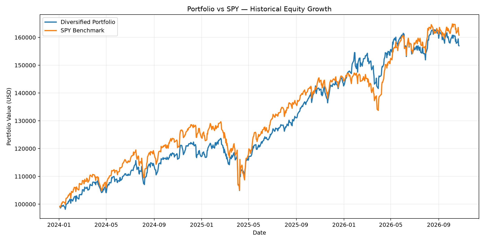
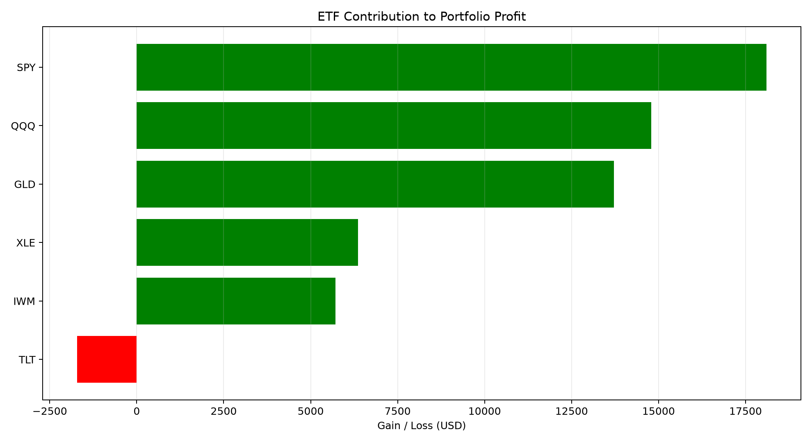

# Portfolio Risk Intelligence Engine

A Python-based portfolio analytics and risk intelligence project that evaluates historical ETF performance, downside risk, concentration, and benchmark-relative returns using market data, SQLite, and automated reporting.

## Project Overview

This project models a $100,000 buy-and-hold portfolio consisting of six exchange-traded funds (ETFs), with an initial investment date of January 2, 2024 and market observations through October 23, 2026.

It demonstrates an end-to-end analytical workflow: market data ingestion, transaction storage, portfolio valuation, quantitative risk measurement, performance attribution, visualization, and automated report generation.

## Portfolio Composition

| ETF | Exposure | Initial Target Weight |
|---|---|---:|
| SPY | US Large-Cap Equity | 30% |
| QQQ | US Growth Equity | 20% |
| IWM | US Small-Cap Equity | 15% |
| GLD | Gold | 15% |
| TLT | US Treasuries | 10% |
| XLE | Energy | 10% |

The portfolio uses whole-share purchases and retains uninvested cash.

## Key Results

Historical analysis from January 2024 through October 2026, using 705 aligned daily return observations.

| Metric | Diversified Portfolio | SPY Benchmark |
|---|---:|---:|
| Ending Value | $156,975.11 | $160,789.17 |
| Cumulative Return | 56.98% | 60.79% |
| Annualized Return | 17.49% | 18.50% |
| Annualized Volatility | 13.63% | 15.46% |
| Maximum Drawdown | 15.16% | 19.00% |
| Sharpe Ratio | 1.25 | 1.18 |

### Key Findings

- The diversified portfolio underperformed SPY by 3.81 percentage points in cumulative returns.
- Annualized volatility was 1.83 percentage points lower than SPY.
- Maximum drawdown was 3.84 percentage points lower than SPY.
- The portfolio achieved a higher historical Sharpe ratio (1.25 versus 1.18), assuming a 0% risk-free rate.
- Portfolio beta against SPY was approximately 0.81.
- Historical 95% daily Value at Risk (VaR) was 1.38%, while Conditional Value at Risk (CVaR) was 2.00%.

These findings illustrate the trade-off between absolute performance and historical risk-adjusted returns.

## Portfolio Visualizations

### Portfolio Growth vs SPY



### Historical Drawdowns


### Allocation Drift


### ETF Performance Attribution



## Features

- Historical market data ingestion and storage
- SQLite-based portfolio and transaction management
- Cash-flow-aware portfolio return calculations
- Benchmark performance comparison
- Annualized volatility and maximum drawdown
- Historical Value at Risk and Conditional Value at Risk
- Portfolio beta and concentration analysis
- Security-level performance attribution
- Portfolio allocation drift visualization
- Automated Markdown reporting
- Automated testing with pytest

## Technology Stack

**Python · Pandas · NumPy · Matplotlib · SQLite · Tiingo · yfinance · pytest**

## Project Structure

```text
portfolio-risk-engine/
├── src/riskengine/
│   ├── db/           # Database models and transaction operations
│   ├── ingestion/    # Market data ingestion
│   └── risk/         # Risk, returns, attribution and reporting
├── scripts/          # Analysis and visualization scripts
├── tests/            # Automated test suite
├── reports/          # Generated reports and charts
├── data/             # Local databases (excluded from Git)
├── pyproject.toml
└── README.md
```

## Windows local quickstart

Requires Python 3.11 or later and Node.js/npm on PATH. From Windows CMD:

```cmd
git clone <repository-url>
cd portfolio-risk-engine
python -m venv .venv
.venv\Scripts\activate
python -m pip install -e ".[dev]"
cd frontend
npm.cmd ci
cd ..
```

Replace `<repository-url>` with the actual GitHub repository URL.

Provision a usable Portfolio Risk Engine SQLite database before starting. By default FastAPI opens
`data\historical_portfolio.db`. Historical database files are excluded from Git, and a fresh checkout
does not include a usable database. To use an existing database elsewhere, set `RISKENGINE_DB` to its path.
`RISKENGINE_DEMO=1` takes precedence over `RISKENGINE_DB` and selects `data\demo_portfolio.db`, which must also
be provisioned. Use `set "RISKENGINE_DEMO="` in CMD to clear demo mode.

```cmd
rem Optional: select a portfolio ID that exists in the chosen database (default: 1)
set "VITE_PORTFOLIO_ID=1"
dev.cmd
```

Use the browser tab opened by `dev.cmd`. Before printing `Ready`, the launcher verifies database
readiness and waits for the current browser session to return its cookie in a successful
authenticated session check. The backend confirms this on its private launcher connection.
The displayed URL contains no launch code.
While FastAPI is running, http://127.0.0.1:8000/health checks process liveness and
http://127.0.0.1:8000/ready checks database access and required schema. If startup reports a database
problem, check which file the environment selects and whether it exists, is readable, and has the
application schema. If a page reports a missing portfolio after startup, check that
`VITE_PORTFOLIO_ID` exists in the selected database. An empty database can pass readiness.
Type `stop` then Enter (or press Ctrl+C), wait for shutdown, and run `dev.cmd` again after changing settings.
See the [frontend README](frontend/README.md) for the seven routes and port overrides.

### Local access protection

`dev.cmd` runs both listeners on IPv4 loopback. Use the exact `127.0.0.1` address and configured
port. `localhost`, IPv6, other hosts and forwarded host overrides are rejected in protected mode.
The Vite proxy preserves the original Host. The API checks that Host and any supplied Origin
match the configured local access policy. Cross-site browser request metadata and null Origin
are rejected. Missing Origin is allowed for authorized reads and local probes. Cross-origin
requests receive no CORS grant.

The launcher opens the browser with a random, single-use launch code in the URL fragment.
It expires after three minutes and can be briefly visible in the Windows dispatch arguments and
browser navigation state. The app removes the fragment before exchanging the code in a request
header. The launcher does not print it. The backend issues an in-memory, host-only, HttpOnly,
SameSite=Strict session cookie scoped to `/api`. Development uses loopback HTTP, so the cookie
does not require HTTPS. A session lasts at most 12 hours and is invalidated on backend restart.
Refresh and other tabs in the same browser profile can reuse it.

Allow cookies for this local application and use the tab opened by `dev.cmd`. Browser authorization
must be confirmed within 30 seconds of dispatch. If it fails, the launcher reports the problem and
stops its servers. Check your browser's site-specific cookie settings and default browser setup,
then run `dev.cmd` again. On session loss the app clears its financial views on the next failed
request, focus check, or scheduled session check. Background tabs can delay the scheduled check.
Refresh if a new launcher tab already established a session. Otherwise restart `dev.cmd`.

All financial API routes, including report exports, require a valid session and use `no-store`.
`/health` and `/ready` remain session-independent under the local Host and Origin rules.
Interactive API docs and OpenAPI are hidden in protected mode. A future unsafe API request
must use the exact browser Origin, a valid session, and the non-simple `X-RiskEngine-Request`
header. There are no financial write endpoints.

Protected startup fails if its launcher configuration is unavailable. An explicit
`RISKENGINE_API_MODE=legacy-read-only` is available for isolated developer read-contract testing.
It bypasses local access guards and refuses unsafe HTTP methods. Keep it on loopback with disposable
data. The supported launcher always selects protected mode. The cookie and same-origin exchange
can be reused with future same-origin asset serving. Production packaging is separate work.

This protects against unrelated websites, cross-origin requests, CSRF, DNS rebinding, and direct
requests without the session. The application does not isolate other processes running as the same
OS user. Malware, a compromised browser or privileged extension, administrator access, and physical
access to an unlocked device are outside this boundary. Different browser-facing ports use
different cookie names, so legitimate instances with separate project directories and port pairs
can run in one browser profile. Cookies are scoped by host and path. Their names prevent collisions
between instances and do not provide confidentiality across TCP ports. A local process that owns
another port on the same host is outside this threat model.

### Set up a managed database

After installing the backend in `.venv`, run one of these commands from the repository root in
Windows CMD. Both create a new `%LOCALAPPDATA%\Portfolio Risk Engine\portfolio.db`.

```cmd
.venv\Scripts\python.exe -m riskengine.db.lifecycle create
.venv\Scripts\python.exe -m riskengine.db.lifecycle adopt "D:\My Portfolio\existing.db"
```

`create` starts with empty tables. `adopt` copies a compatible database using a SQLite snapshot,
including committed WAL data visible to SQLite. It leaves the source database in place. Both
commands refuse to replace an existing database. Use `--data-root "D:\My Portfolio\Isolated"` after
the subcommand to choose a different absolute local directory outside the repository.

SQLite locates journal, WAL and shared-memory files using the database filename. Both
`adopt` and `inspect` reject a source with multiple filesystem hard links because SQLite
could read a different set of journal files and miss committed data. Use a standalone copy made
with a supported SQLite backup or export. Read-only WAL access preserves the source's financial
records and schema version. SQLite can still create sidecars or update shared-memory state.
The path checks address ordinary misuse and supported concurrent setup operations. They do not
provide isolation from arbitrary filesystem changes by another process running as the same OS user.

```cmd
.venv\Scripts\python.exe -m riskengine.db.lifecycle inspect "%LOCALAPPDATA%\Portfolio Risk Engine\portfolio.db"
set "RISKENGINE_DEMO="
set "RISKENGINE_DB=%LOCALAPPDATA%\Portfolio Risk Engine\portfolio.db"
dev.cmd
```

`inspect` checks compatibility and reports the schema version. The original V1 schema uses version
0. Managed copies and new databases use version 1 with the same financial schema. Setup checks the
project's schema definitions conservatively and can reject customized schemas. Compatibility does
not require portfolio records or complete market-price history. Setup does not change the launcher's
default database selection or upgrade an existing database in place.

Adoption stops after 30 seconds of continuously reported SQLite backup contention. The timer
resets when backup makes progress, and individual SQLite calls can take additional time.
An abrupt interruption can leave an unpublished `.portfolio-setup-*.db` file. The next attempt uses
a new temporary filename. If cleanup fails, setup reports the retained path.

### Run Tests

```cmd
python -m pytest tests\ -q
```

Latest local test result: **309 passed, 2 deselected**.

### Historical Data

The historical portfolio database is not included in the repository. Historical data ingestion uses Tiingo and requires an API key.

The historical portfolio builder is available at:

```text
scripts/build_historical_portfolio.py
```

The generated historical portfolio report is available at:

```text
reports/portfolio_intelligence_report.md
```

The portfolio builder creates a new local historical database and should not be rerun against an existing database without reviewing its initialization behavior.

## Methodology and Limitations

- The portfolio follows a buy-and-hold investment strategy.
- Performance is calculated from historical market observations.
- Portfolio returns account for external cash flows.
- The SPY benchmark uses raw closing prices rather than dividend-adjusted total returns.
- Dividends and distributions are not explicitly modeled in the benchmark comparison.
- Annualization assumes 252 trading days per year.
- The Sharpe ratio assumes a 0% annual risk-free rate.
- Concentration metrics exclude uninvested cash.
- Exposure classifications describe investment styles and asset classes, not necessarily underlying industry-sector allocations.
- Historical risk measurements do not guarantee future performance.

## Detailed Report

See [Portfolio Intelligence Report](reports/portfolio_intelligence_report.md) for the complete risk assessment, performance comparison, exposure analysis, and visualizations.

---

*This project is intended for portfolio analytics, financial risk analysis, and educational demonstration. It is not investment advice.*
